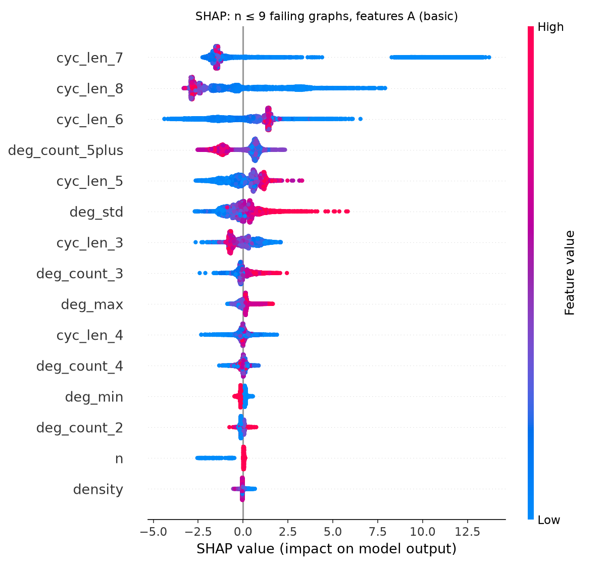
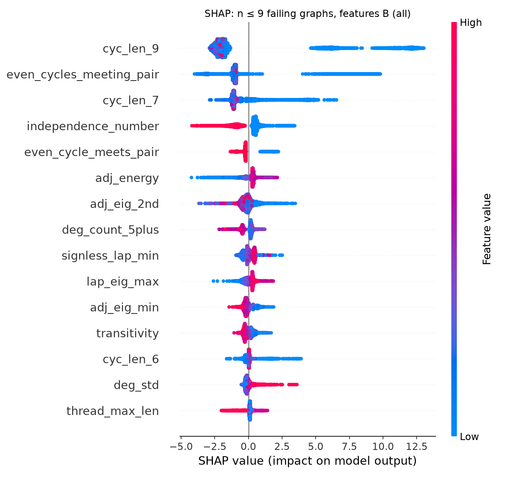
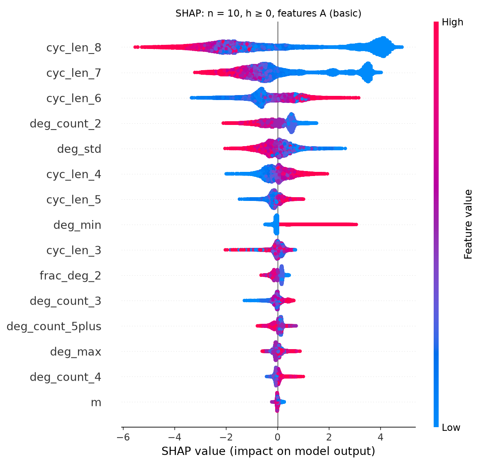
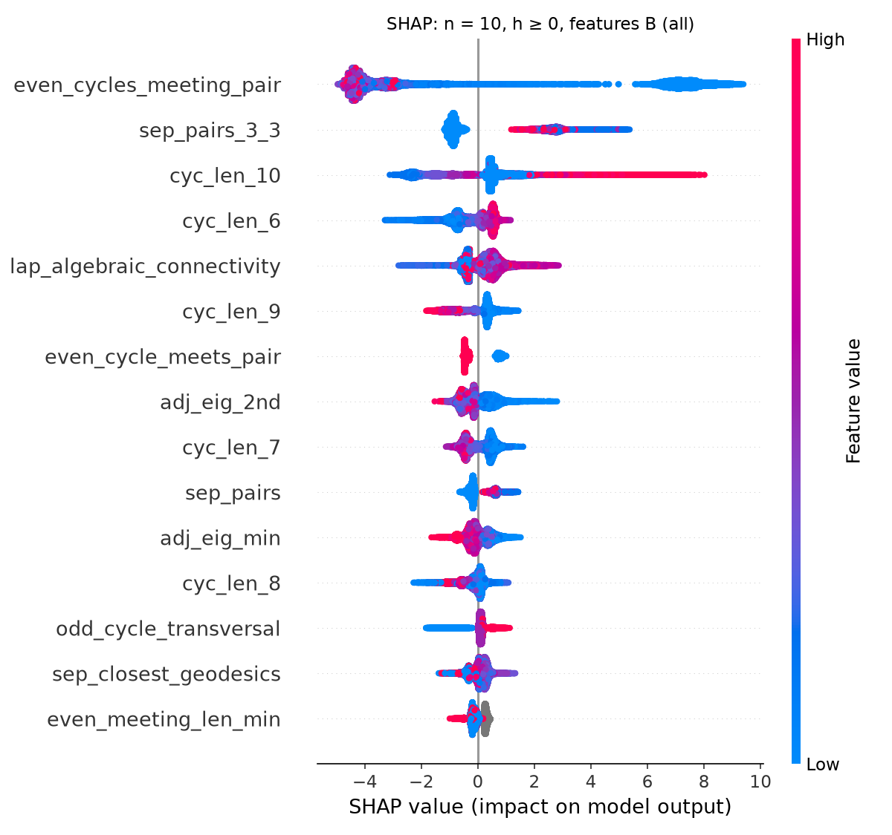

# LightGBM + SHAP: predicting CM for graphs failing OCC

Generated by `scripts/lgbm_shap.py`. Label: k[G] Cohen–Macaulay (1) or not (0). Features are purely
graph-theoretic (no Macaulay2 output). Feature set A: `n`, `m`, `m_minus_n`, `density`, `n_components`, `deg_min`, `deg_max`, `deg_mean`, `deg_std`, `deg_count_2`, `deg_count_3`, `deg_count_4`, `deg_count_5plus`, `frac_deg_2`, `cyc_len_3`, `cyc_len_4`, `cyc_len_5`, `cyc_len_6`, `cyc_len_7`, `cyc_len_8`.
Feature set B: A plus all 64 other numeric structural features.

n = 10 labels: CM = depth 10 over ZZ/32003 (proved); not CM = negative h-coefficient (proved) or depth < 10
over ZZ/32003 (screen). The n = 10 set is every graph with h ≥ 0 and known depth plus a random sample of 40,000 graphs with a negative h-coefficient.

| experiment | features | graphs (CM / not) | accuracy | balanced acc. | AUC |
|---|---|---|---|---|---|
| 1. CV, n ≤ 9 | A (basic) | 782 / 6,510 | 0.982 | 0.963 | 0.996 |
| 1. CV, n ≤ 9 | B (all) | 782 / 6,510 | 0.997 | 0.991 | 1.000 |
| 2. train n ≤ 9 → test n = 10 (all sampled) | A (basic) | 11,533 / 53,022 | 0.877 | 0.669 | 0.915 |
| 2. train n ≤ 9 → test n = 10 (h ≥ 0 only) | A (basic) | 11,533 / 13,022 | 0.685 | 0.666 | 0.806 |
| 2. train n ≤ 9 → test n = 10 (all sampled) | B (all) | 11,533 / 53,022 | 0.942 | 0.838 | 0.912 |
| 2. train n ≤ 9 → test n = 10 (h ≥ 0 only) | B (all) | 11,533 / 13,022 | 0.848 | 0.838 | 0.889 |
| 3. CV, n = 10 with h ≥ 0 | A (basic) | 11,533 / 13,022 | 0.921 | 0.920 | 0.979 |
| 3. CV, n = 10 with h ≥ 0 | B (all) | 11,533 / 13,022 | 0.995 | 0.995 | 1.000 |

## Most important features (mean |SHAP|, log-odds of CM)

**n9_basic** — 

| feature | mean abs. SHAP |
|---|---|
| `cyc_len_7` | 2.434 |
| `cyc_len_8` | 2.013 |
| `cyc_len_6` | 1.330 |
| `deg_count_5plus` | 0.883 |
| `cyc_len_5` | 0.733 |
| `deg_std` | 0.610 |
| `cyc_len_3` | 0.566 |
| `deg_count_3` | 0.288 |
| `deg_max` | 0.220 |
| `cyc_len_4` | 0.201 |

**n9_all** — 

| feature | mean abs. SHAP |
|---|---|
| `cyc_len_9` | 3.542 |
| `even_cycles_meeting_pair` | 1.868 |
| `cyc_len_7` | 1.207 |
| `independence_number` | 0.751 |
| `even_cycle_meets_pair` | 0.447 |
| `adj_energy` | 0.400 |
| `adj_eig_2nd` | 0.345 |
| `deg_count_5plus` | 0.315 |
| `signless_lap_min` | 0.286 |
| `lap_eig_max` | 0.282 |

**n10_hnonneg_basic** — 

| feature | mean abs. SHAP |
|---|---|
| `cyc_len_8` | 2.479 |
| `cyc_len_7` | 1.408 |
| `cyc_len_6` | 0.748 |
| `deg_count_2` | 0.495 |
| `deg_std` | 0.427 |
| `cyc_len_4` | 0.393 |
| `cyc_len_5` | 0.196 |
| `deg_min` | 0.149 |
| `cyc_len_3` | 0.145 |
| `frac_deg_2` | 0.141 |

**n10_hnonneg_all** — 

| feature | mean abs. SHAP |
|---|---|
| `even_cycles_meeting_pair` | 4.860 |
| `sep_pairs_3_3` | 1.443 |
| `cyc_len_10` | 1.323 |
| `cyc_len_6` | 0.599 |
| `lap_algebraic_connectivity` | 0.553 |
| `cyc_len_9` | 0.545 |
| `even_cycle_meets_pair` | 0.534 |
| `adj_eig_2nd` | 0.441 |
| `cyc_len_7` | 0.436 |
| `sep_pairs` | 0.352 |

